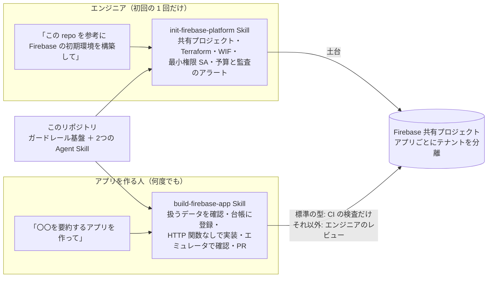

<div align="center">

# 🛡️ Antigravity Firebase Guardrail

[English](README.md) | **日本語**

**AI エージェントで社内アプリを量産するための、Firebase のガードレール基盤。**

1 つの Firebase 共有プロジェクトに、複数のアプリを「テナント」として分離して同居させます。<br/>
エンジニアは土台を 1 回作るだけ。アプリを作る人は、やりたいことを AI に伝えるだけ。

[](https://github.com/reizist/antigravity-firebase-guardrail/actions/workflows/ci.yml)
[](LICENSE)
[](https://antigravity.google)


</div>

---

## 💡 Why

非エンジニアが AI で社内アプリを作れるようになった一方で、セキュリティやプライバシーの確認はエンジニアのレビューに頼ったままです。作る人は待たされ、エンジニアは五月雨式のレビューに追われます。

| | Agent Skill（AI への指示） | 仕組み（Terraform・IAM・ビルド設定・CI） |
|---|---|---|
| **担うこと** | 手順の再現 · 実装パターンの誘導 | 越えてはならない境界 |
| **ぶれたとき** | AI の出力は、ぶれることがある | 権限と検査の側で止まる |

長い規約書を配る代わりに、**ガードレール基盤と、立場別の 2 つの [Agent Skill](https://antigravity.google/docs/skills) を同じリポジトリに入れて**あります。エンジニアもアプリを作る人も、このリポジトリを AI に読ませて、対話しながら進めます。



## ✨ What it does

| ガードレール | 何を防ぐか | どこで |
|---|---|---|
| **レビュー待ちの列を作らない 2 つのレーン** | アプリを作るたびにエンジニアの承認を待つこと。標準の型（Tier 0・個人情報なし・事前に承認した Rules テンプレート・シークレットなし・外部への送信なし）に収まるアプリは `platform/catalog/self-service/` に登録し、レビューも承認もなしでデータベースまで払い出す。それ以外は `apps.yaml` でエンジニアがレビューする | `pnpm policy`（レーンの判定。PR にコメント）、`plan-guard.mjs`（plan がそのアプリのテナントだけのときに限り自動で反映）、CODEOWNERS |
| **コードを書く前のデータの確認** | 個人情報・社外秘が、セルフサービスのデータベースに入ること | Skill（個人情報・外部への送信・保持期間を聞く）＋ `pnpm policy`（Tier 0 の `handles_pii: true`・`confidential` を止め、`safeFetch` を通さない `fetch()` を見つける）＋ PR のチェックリスト |
| **予算アラートと、データベース作成のアラート** | 費用の暴走、台帳を通さないデータベース。予算は Pub/Sub とメールに通知する（通知だけで、課金は止まらない）。監査ログの `CreateDatabase` を通知し、Terraform SA 以外が作ったときは重大として通知する | `budget.tf`、`audit_alerts.tf`（どちらも既定で作る） |
| **Security Rules の反映は Terraform だけ** | Rules の権限はプロジェクト単位でしか付けられない。アプリのデプロイ経路に渡すと、他のアプリの DB を全開放できてしまう | デプロイ SA に `firebaserules.*` の反映権限を付けない。独自の `apps/*/firestore.rules` は CODEOWNERS でレビュー必須、反映は `deploy.yml` の platform ジョブ（承認つき）。標準テンプレートは `platform/rules-templates/` |
| **Tier 0 は HTTP 関数を作らない** | 認証チェック漏れ・公開設定ミス。画面からは Firestore に書き込み、Firestore トリガーと `onSchedule` で処理する | Skill ＋ `pnpm policy`（`onRequest` / `onCall` を検出） |
| **サプライチェーン対策** | 乗っ取られたパッケージ・`postinstall` の悪用。Functions はクラウド側で依存を入れ直すので、esbuild で 1 ファイルにまとめ、クラウド側で入る依存を 2 つに絞る | `pnpm-workspace.yaml`、依存の許可リスト、OSV-Scanner |
| **`(default)` DB・既定のバケットを作らない** | DB 名の指定を忘れたときに、共有の場所へ書き込むこと | Terraform（作らない）＋ デプロイ SA に DB を作る権限がない |
| **テナントごとの実行 SA と IAM Conditions** | 関数が他のアプリの DB・シークレットを読むこと | `modules/app-tenant` |
| **鍵なしのデプロイ（WIF）** | 手元の PC に本番の権限を置くこと。SA を借用できるのは `main` で動くワークフローだけ | `bootstrap/github_wif.tf`、`deploy.yml` |
| **台帳と有効期限** | 誰も管理していないアプリが残り続けること | `platform/catalog/`、`pnpm policy`（期限切れは CI が失敗） |

設計の詳細は [docs/platform_design.md](./docs/platform_design.md)、最小権限の `firebase deploy` でつまずいた点と対処は同 §9 にあります。

## 🚀 Getting started

### エンジニア（最初に 1 回）

1. このリポジトリを「Use this template」で自分の GitHub にコピーし、clone する（業務で使うなら private にする）
2. Antigravity（または使っている AI エージェント）でリポジトリを開き、依頼する

   > このリポジトリと初期構築 Skill を参考に、Firebase のガバナンス付き共有プロジェクトの初期環境（予算アラート・DB 作成監査アラート含む）を構築して。クラウドへ反映する前に必ず差分を見せて確認して。

   明示的に呼ぶなら `/init-firebase-platform`。手作業で進めるなら [docs/runbook.md](./docs/runbook.md)。

必要なもの：有効な Google Cloud 課金アカウント（または課金紐付け済みの既存プロジェクト＋`create_project = false`）、`gcloud`・`terraform`・Node.js 24・`pnpm`。

> [!NOTE]
> **初回構築で自動化されること／初回だけ手作業が必要なこと**
> - **自動化（Terraform）**：GCP プロジェクト作成・課金アカウント紐付け（これにより Firebase の Blaze 従量課金プランが自動で有効になるため、Firebase コンソールでのプラン切替は不要）・API 限定有効化・WIF・最小権限 SA・予算／クォータ／DB 作成監査アラート
> - **初回のみ手作業**：課金アカウント自体がまだ無い場合の事前作成、Firebase コンソールでの **Google ログイン有効化**（OAuth クライアントは API から作れないため。Skill が手順を案内）、および Webhook URL 等のシークレット値登録

### アプリを作る人（何度でも）

1. リポジトリを Antigravity で開く
2. 作りたいアプリを日本語で伝える

   > このリポジトリのアプリ量産 Skill を使って、Firebase アプリを作って。チームで使う社内リンク集とメモ共有ツールが欲しい。

3. エージェントの質問（個人情報を扱うか、外部へ送るか、いつまで残すか）に答える。コードを書く前に聞かれます
4. 手元の画面（エミュレータ。本番にはつながらない）で動きを確かめ、直してほしい点を伝える
5. できあがったら「GitHub に PR を作って」と頼む

Google Cloud コンソールも Terraform も触りません。手元の PC に本番のデプロイ権限はありません。標準の型に収まるアプリは、マージされるとエンジニアを挟まずに CI が公開します。エンジニアが確認するのは例外だけで、**レビューする台帳（`apps.yaml`）と独自の Security Rules（`firestore.rules`）の差分** です。シークレットや外部への送信があるアプリ（見本の `news-watcher` など）、独自のアクセス制御が要るアプリがここに入ります。

必要なもの：GitHub アカウント、Antigravity、Node.js 24・`pnpm`、Java 21 以上（エミュレータ用）。

## 🧩 What's inside

```text
.
├── AGENT.md                                 # リポジトリ全体の規約（AI が参照する基本方針）
├── .agents/
│   └── skills/
│       ├── init-firebase-platform/          # 【エンジニア向け】初回のガードレール構築 Skill
│       │   └── SKILL.md
│       └── build-firebase-app/              # 【アプリを作る人向け】アプリ量産 Skill
│           ├── SKILL.md
│           └── reference.md                 #   名前の付け方・Rules と関数の雛形
├── platform/
│   ├── config.json                          # 環境の値（プロジェクト ID・社内ドメインなど）はここ 1 か所
│   ├── catalog/
│   │   ├── apps.yaml                        # エンジニアがレビューするアプリ（独自の Rules・シークレット・外部への送信）
│   │   └── self-service/                    # 標準の型に収まる Tier 0 のアプリ（1 アプリ 1 ファイル。レビューなしで自動反映）
│   ├── rules-templates/                     # 事前に承認した標準の Security Rules
│   ├── terraform/                           # 共有プロジェクト・WIF・デプロイ SA・予算と監査のアラート・テナント
│   └── policies/                            # CI のポリシーチェック・レーンの判定・plan の確認・依存の許可リスト
├── apps/
│   └── news-watcher/                        # 第 1 号アプリ（RSS を Gemini で採点・要約して Slack に配信）
├── scripts/                                 # bootstrap / deploy / destroy
├── .github/                                 # CI・デプロイ・CODEOWNERS・Issue テンプレート
├── docs/                                    # 設計・手順
└── pnpm-workspace.yaml                      # サプライチェーン対策（公開から 7 日待つ・スクリプトは許可制）
```

| Skill | 相手 | やること |
|---|---|---|
| [`init-firebase-platform`](./.agents/skills/init-firebase-platform/SKILL.md) | エンジニア | 共有プロジェクト・WIF・最小権限 SA・予算と監査のアラート・テナントを、差分を確認しながら構築する |
| [`build-firebase-app`](./.agents/skills/build-firebase-app/SKILL.md) | アプリを作る人 | 扱うデータを確かめ、合うほうの台帳に登録し、規約どおりに実装し、エミュレータで確かめ、PR を出す |

## 📊 Verification status

| 領域 | 状態 | 内容 |
|---|---|---|
| 共有基盤・テナント払い出し | 実機で検証済み（※） | Terraform（テナントの 7 リソースを一括作成）、`(default)` DB を作らない構成、Rules を Terraform で反映、Artifact Registry の npm リモートリポジトリ |
| 最小権限デプロイ・news-watcher | 実機で検証済み（※） | デプロイ SA ＋ `scripts/deploy_app.sh`、pnpm の保護設定 ＋ esbuild の 1 ファイルバンドル、news-watcher（Gemini の採点・要約、Slack への共有） |
| 公開にあたって一般化した部分 | **静的な検証のみ** | `platform/config.json` への設定の集約、WIF のブランチ単位の制限（`attribute.repo_ref`）、bash に書き直したスクリプト、GitHub Actions の `deploy.yml`。`terraform validate`・単体テスト・ポリシーチェック・CI は通っているが、この形のまま新しいプロジェクトに適用して確かめてはいない |
| CI のポリシーチェック | 実装済み（簡易） | 台帳・レーンの判定・`firebase.json` の担当範囲・HTTP 関数の禁止・Rules・依存の許可リスト・秘密情報。文字列と正規表現による検査で、構文解析はしていない |
| 2 つのレーン・予算アラート・データベース作成のアラート・TTL | **手元の検証のみ** | `terraform validate`、ポリシーチェックと plan の確認の単体テスト、標準の Rules テンプレート 2 つを Firestore エミュレータで動かした許可・拒否の確認。実際のプロジェクトにはまだ適用しておらず、`deploy.yml` の自動反映のジョブは GitHub Actions の上で動かしていない |
| まだ無いもの | 未実装 | CI での Rules のユニットテスト、gitleaks、2 つ目のテナントでの分離の実機確認、Tier 1 の Storage バケット、App Check |

※ 作者の検証環境で、一般化する前の構成（プロジェクト ID などを直接書いた状態）で確認したものです。

<details>
<summary><b>🛠️ Development</b></summary>

```bash
corepack enable pnpm
pnpm install --frozen-lockfile
pnpm policy                     # ポリシーチェック
pnpm policy:test                # ポリシーチェックのテスト
pnpm typecheck && pnpm test     # news-watcher の単体テスト
pnpm build
terraform fmt -check -recursive platform/terraform
```

クラウドには一切つながりません（Google Cloud の認証情報は不要）。

</details>

---

## 🤝 Contributing

MIT の個人プロジェクトです。Issue・PR・⭐ いずれも歓迎します。[CONTRIBUTING.md](CONTRIBUTING.md) を見てください。脆弱性の報告は [SECURITY.md](SECURITY.md) へ。

---

## ⚠️ Disclaimer

コミュニティプロジェクトです。**Google とは無関係で、Google による承認・サポートを受けたものではありません。** 内容は作者個人の見解に基づきます。"Antigravity"・"Gemini"・"Firebase"・"Google Cloud" は、それぞれの権利者の商標です。このリポジトリを使って作成した Google Cloud のリソースの費用・認証情報・データの扱いは、利用者自身の責任で管理してください。検証の範囲は「Verification status」のとおりで、本番で使う前に自分の環境で確かめてください。MIT ライセンス — [LICENSE](LICENSE)。
