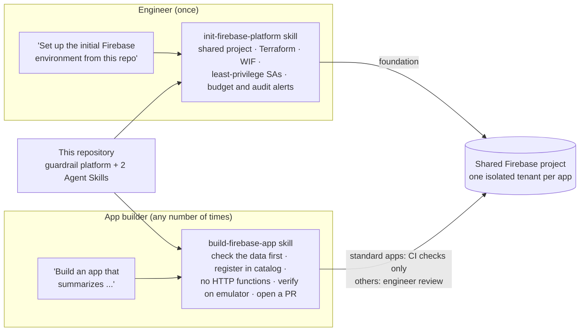

<div align="center">

# 🛡️ Antigravity Firebase Guardrail

**English** | [日本語](README.ja.md)

**Firebase guardrails for mass-producing internal apps with AI agents.**

Many apps share one Firebase project, each isolated as its own "tenant".<br/>
Engineers build the foundation once. App builders just tell an AI agent what they want.

[](https://github.com/reizist/antigravity-firebase-guardrail/actions/workflows/ci.yml)
[](LICENSE)
[](https://antigravity.google)


</div>

---

## 💡 Why

Non-engineers can now build real internal apps with AI. Security and privacy checks, however, still depend on engineers reviewing each one. Builders wait, and engineers drown in a steady trickle of reviews.

| | Agent Skills (instructions to the AI) | Mechanisms (Terraform · IAM · build config · CI) |
|---|---|---|
| **Owns** | repeatable procedure · steering toward safe patterns | the boundaries that must not be crossed |
| **When it drifts** | AI output can vary | permissions and checks stop it |

Instead of handing out a long rulebook, this repository ships **the guardrail platform and two role-specific [Agent Skills](https://antigravity.google/docs/skills) together**. Engineers and app builders both point an AI agent at this repository and work through it in conversation.



## ✨ What it does

| Guardrail | What it prevents | Where |
|---|---|---|
| **Two lanes instead of a review queue** | Every new app waiting for an engineer. Apps that fit the standard shape (Tier 0, no personal data, a pre-approved Rules template, no secrets, no outbound calls) are registered in `platform/catalog/self-service/` and get their database without review or approval. Everything else goes through `apps.yaml` and engineer review | `pnpm policy` (lane verdict, posted on the PR), `plan-guard.mjs` (auto-apply only when the plan touches nothing but that app's tenant), CODEOWNERS |
| **Data check before any code** | Personal or confidential data landing in a self-service database | Skill (asks about personal data, outbound calls, retention) + `pnpm policy` (blocks `handles_pii: true` or `confidential` in Tier 0, flags `fetch()` that bypasses `safeFetch`) + PR checklist |
| **Budget alerts and database-creation alerts** | Runaway cost; databases created outside the catalog. Budgets notify Pub/Sub and email (they notify only — they do not stop billing). Every `CreateDatabase` audit log entry raises an alert, and one made by anyone but the Terraform SA raises a critical one | `budget.tf`, `audit_alerts.tf` (both on by default) |
| **Only Terraform deploys Security Rules** | Rules permissions can only be granted project-wide. Give them to an app's deploy path and it can open every other app's database | The deployer SA has no permission to release `firebaserules.*`. Custom `apps/*/firestore.rules` requires CODEOWNERS review and is applied by the platform job in `deploy.yml` with approval; standard templates live in `platform/rules-templates/` |
| **No HTTP functions in Tier 0** | Missing auth checks and accidental public exposure. The UI only writes to Firestore; Firestore triggers and `onSchedule` do the work | Skill + `pnpm policy` (detects `onRequest` / `onCall`) |
| **Supply-chain protection** | Hijacked packages and `postinstall` abuse. Cloud Functions reinstalls dependencies in the cloud, so functions are bundled into one file with esbuild and only two dependencies are installed cloud-side | `pnpm-workspace.yaml`, dependency allowlist, OSV-Scanner |
| **No `(default)` database or default bucket** | Writing to a shared location when someone forgets to name the database | Terraform never creates them, and the deployer SA cannot create databases |
| **Per-tenant runtime SA with IAM Conditions** | A function reading another app's database or secrets | `modules/app-tenant` |
| **Keyless deploys (WIF)** | Production credentials on a laptop. Only workflows running on `main` can impersonate the service accounts | `bootstrap/github_wif.tf`, `deploy.yml` |
| **App catalog with expiry dates** | Apps that nobody owns living on forever | `platform/catalog/`, `pnpm policy` (an expired app fails CI) |

Design details are in [docs/platform_design.md](./docs/platform_design.md) (Japanese). Section 9 of that document lists the places where a least-privilege `firebase deploy` got stuck, and the fix for each.

## 🚀 Getting started

### Engineers (once)

1. Copy this repository into your own GitHub account with **Use this template**, then clone it. Make it private if you use it for work.
2. Open the repository in Antigravity (or the AI agent you use) and ask:

   > Using this repository and the initial setup skill, build the initial environment for a governed, shared Firebase project, including budget alerts and database-creation audit alerts. Always show me the diff and ask before applying anything to the cloud.

   To call the skill explicitly, use `/init-firebase-platform`. To do it by hand, follow [docs/runbook.md](./docs/runbook.md) (Japanese).

You need: a Google Cloud account that can enable billing, `gcloud`, `terraform`, Node.js 24, and `pnpm`.

### App builders (any number of times)

1. Open the repository in Antigravity.
2. Describe the app you want:

   > Use this repository's app-building skill to make a Firebase app. I want a shared link collection and memo tool for my team.

3. Answer the agent's questions about the data (personal data, outbound calls, how long to keep it). It asks before writing any code.
4. Try it on the local emulator, which never connects to production, and say what you want changed.
5. When it looks right, ask the agent to open a pull request on GitHub.

App builders never touch the Google Cloud console or Terraform, and their machine holds no production deploy permission. An app that fits the standard shape is published by CI after the merge with no engineer in the loop. Engineers review only the exceptions: **the reviewed catalog (`apps.yaml`) and custom Security Rules (`firestore.rules`)**, which is where apps with secrets, outbound calls (like the `news-watcher` sample), or their own access rules go.

You need: a GitHub account, Antigravity, Node.js 24, `pnpm`, and Java 21 or later (for the emulator).

> [!NOTE]
> The skills, `AGENT.md`, the docs, and code comments are written in Japanese. The agent is instructed to reply in Japanese.

## 🧩 What's inside

```text
.
├── AGENT.md                                 # Repository-wide rules the AI agent reads first
├── .agents/
│   └── skills/
│       ├── init-firebase-platform/          # [Engineers] initial guardrail setup skill
│       │   └── SKILL.md
│       └── build-firebase-app/              # [App builders] app-building skill
│           ├── SKILL.md
│           └── reference.md                 #   naming rules, Rules and function skeletons
├── platform/
│   ├── config.json                          # The one place for environment values (project ID, domain, ...)
│   ├── catalog/
│   │   ├── apps.yaml                        # Apps that engineers review (custom Rules, secrets, outbound calls)
│   │   └── self-service/                    # Standard-shape Tier 0 apps, one file each: no review, auto-applied
│   ├── rules-templates/                     # Pre-approved standard Security Rules
│   ├── terraform/                           # Shared project, WIF, deployer SA, budget and audit alerts, tenants
│   └── policies/                            # CI policy check, lane verdict, plan guard, dependency allowlist
├── apps/
│   └── news-watcher/                        # First app: scores and summarizes RSS with Gemini, posts to Slack
├── scripts/                                 # bootstrap / deploy / destroy
├── .github/                                 # CI, deploy, CODEOWNERS, issue templates
├── docs/                                    # Design and runbook (Japanese)
└── pnpm-workspace.yaml                      # Supply-chain settings (7-day release age, install scripts allowlisted)
```

| Skill | For | What it does |
|---|---|---|
| [`init-firebase-platform`](./.agents/skills/init-firebase-platform/SKILL.md) | Engineers | Builds the shared project, WIF, least-privilege SAs, budget and audit alerts, and tenants, confirming each diff first |
| [`build-firebase-app`](./.agents/skills/build-firebase-app/SKILL.md) | App builders | Checks what data the app handles, registers it in the right catalog, implements it within the rules, verifies it on the emulator, and opens a PR |

## 📊 Verification status

| Area | Status | Details |
|---|---|---|
| Shared platform and tenant provisioning | Verified on a real project (*) | Terraform (creates a tenant's 7 resources at once), no `(default)` database, Rules deployed by Terraform, Artifact Registry npm remote repository |
| Least-privilege deploy and news-watcher | Verified on a real project (*) | Deployer SA + `scripts/deploy_app.sh`, pnpm protections + single-file esbuild bundle, news-watcher (Gemini scoring and summaries, sharing to Slack) |
| Parts generalized for this public release | **Static checks only** | Centralizing settings in `platform/config.json`, restricting WIF per branch (`attribute.repo_ref`), scripts rewritten in bash, the `deploy.yml` workflow. `terraform validate`, unit tests, the policy check, and CI all pass, but this exact form has not been applied to a fresh project |
| CI policy check | Implemented (simple) | Catalog, lane verdict, `firebase.json` scope, no HTTP functions, Rules, dependency allowlist, secrets. It uses strings and regular expressions, not a parser |
| Two lanes, budget alerts, database-creation alerts, TTL | **Local checks only** | `terraform validate`, unit tests for the policy check and the plan guard, and both standard Rules templates exercised on the Firestore emulator (allow/deny cases). Not yet applied to a real project, and the auto-apply job in `deploy.yml` has not run on GitHub Actions |
| Not there yet | Not implemented | Rules unit tests in CI, gitleaks, a real-project check of isolation with a second tenant, Storage buckets for Tier 1, App Check |

(*) Verified in the author's test environment, in the form before it was generalized (with the project ID and similar values written directly).

<details>
<summary><b>🛠️ Development</b></summary>

```bash
corepack enable pnpm
pnpm install --frozen-lockfile
pnpm policy                     # policy check
pnpm policy:test                # tests for the policy check
pnpm typecheck && pnpm test     # news-watcher unit tests
pnpm build
terraform fmt -check -recursive platform/terraform
```

None of this connects to the cloud, so no Google Cloud credentials are needed.

</details>

---

## 🤝 Contributing

A personal, MIT-licensed project. Issues, PRs, and ⭐ are all welcome. See [CONTRIBUTING.md](CONTRIBUTING.md) (Japanese), and [SECURITY.md](SECURITY.md) for reporting vulnerabilities. Issues and PRs in English or Japanese are both fine.

---

## ⚠️ Disclaimer

Community project. **Not affiliated with, endorsed by, or supported by Google.** The content reflects the author's personal views. "Antigravity", "Gemini", "Firebase", and "Google Cloud" are trademarks of their respective owners. You are responsible for the cost of the Google Cloud resources you create with this repository, and for your own credentials and data. The verified scope is listed under "Verification status"; test it in your own environment before using it in production. MIT licensed — see [LICENSE](LICENSE).
