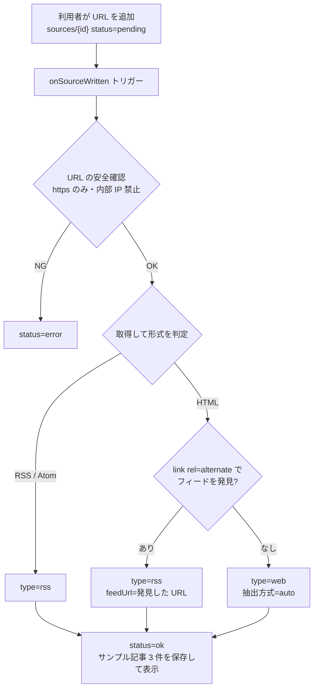
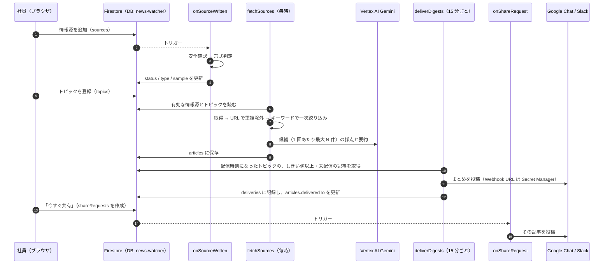

# news-watcher 設計

社内のニュースチャンネルに、業務に必要な情報を自動で集めて共有するアプリ。[ガードレール基盤](./platform_design.md) の **Tier 0（セルフサービス）** の最初のサンプルとして、共有 PJ のテナント `news-watcher` に載せる。

---

## 1. 要件

| # | 要件 | 優先度 |
|---|---|---|
| R1 | **情報源（RSS・特定のサイト）を、利用者が画面から後で自由に追加・停止・削除できる** | 必須 |
| R2 | 情報源から定期的に記事を集め、URL で重複を除く | 必須 |
| R3 | 「監視トピック」（キーワード・関心領域）ごとに関連度を判定し、日本語で短く要約する | 必須 |
| R4 | 関連度がしきい値を超えた記事を、社内のニュースチャンネルにまとめて投稿する | 必須 |
| R5 | 画面で記事を一覧でき、「今すぐ共有」で手動投稿もできる | 必須 |
| R6 | 社員だけが使える（社内ドメインの Google アカウントのみ） | 必須 |
| R7 | 👍/👎 のフィードバックを記録し、関連度判定の改善に使う | あると良い |
| R8 | 配信先を Google Chat から Slack に切り替えられる | 必須（本番は Slack） |

---

## 2. 配信先：Google Chat で作り、Slack にも切り替えられるようにする

本番の配信先は Slack だが、プロトタイプでは Slack 環境の用意に手間がかかるため **Google Chat で作る**。どちらも「Incoming Webhook の URL に JSON を POST する」だけなので、違うのは **メッセージの組み立て部分だけ** で、作り直す手間は小さい。

> [!NOTE]
> **実機での検証は Slack で行った**。台帳のシークレットは `slack-webhook-general`（`NEWS_WATCHER_SLACK_WEBHOOK_GENERAL`）。Google Chat の Notifier はコードとテストに残しておき、Chat が使える環境では `channels/{id}.type` を `google_chat` にすれば切り替えられる（その場合は台帳と `config.ts` にシークレットを追加する）。

| | Google Chat | Slack |
|---|---|---|
| 受け口 | スペースの「アプリと統合 → Webhook」で URL を発行 | Slack アプリを作って Incoming Webhooks を有効化（ワークスペース管理者の承認が要ることが多い） |
| 本文の形式 | `text` ＋ Cards v2 | `text` ＋ Block Kit |
| 実装 | `notifiers/googleChat.ts` | `notifiers/slack.ts` |

- `channels/{channelId}.type` に `google_chat` / `slack` を持たせ、`Notifier` インターフェース（`send(digest): Promise<Result>`）の実装を切り替える
- Webhook URL は **Secret Manager に保存し、Firestore には保存しない**（`channels` にはシークレット名だけを持たせる）
- Slack の実装は Phase 2 の最後に追加し、Webhook がなくても動く単体テスト（ペイロードのスナップショット）で確認しておく

---

## 3. 情報源（R1）の設計

### 3.1 利用者ができること

- 画面に **URL を 1 つ貼るだけ** で追加できる（RSS かどうかを利用者が気にしなくてよい）
- 追加すると「確認中」→「OK（形式：RSS／Web ページ）」または「エラー（理由）」と状態が表示される
- いつでも **停止（`enabled=false`）・再開・削除** できる。削除しても、取得済みの記事は保存期間（TTL）が来るまで残る
- 情報源ごとに、表示名・取得間隔・タグ（例：「競合」「規制」）を編集できる

### 3.2 情報源の種類と判定の流れ

| type | 対象 | 取得方法 |
|---|---|---|
| `rss` | RSS / Atom フィード | フィードを読んで解析 |
| `web` | フィードがない「お知らせ一覧」などのページ | ページを取得して記事リンクを抽出（下記） |
| `google_news` | キーワード検索（Google ニュースの RSS） | 検索語から RSS の URL を作り、`rss` と同じ処理をする |



**`web` 型での記事リンクの抽出**（記事一覧ページから、新しい記事のリンクだけを見つける）

1. `auto`（既定）：ページ内のリンクから記事らしいもの（同じドメイン・パスの深さ・日付らしい文字列など）を規則で選ぶ。うまく選べないときは、HTML を短くして Gemini に「記事のタイトル・URL・日付の一覧」を JSON で出させる
2. `selector`（上級者向け）：CSS セレクタを指定する
3. 前回までに見た URL との差分を新着記事とする

### 3.3 取得時の安全対策（ガバナンス）

利用者が任意の URL を登録できるので、関数が「社内ネットワークや GCP 内部への踏み台」にならないようにする。

- `https://` だけを許可。名前解決した IP がプライベート・ループバック・リンクローカル（`169.254.169.254` のメタデータサーバーを含む）なら拒否する（リダイレクト先も同じ確認をする）
- タイムアウト 10 秒、受け取るのは最大 2 MB、リダイレクトは最大 3 回
- `robots.txt` を守り、User-Agent に `news-watcher (internal; contact: <オーナー>)` を名乗る。同じドメインへのアクセスは、1 回の実行で最大 N 件にする
- 記事の本文は保存しない。保存するのはタイトル・URL・公開日時・自前の要約だけ（著作権への配慮）

---

## 4. 処理の流れ



- **公開 HTTP の関数は作らない**（Tier 0 のルール）。画面からの操作はすべて Firestore への書き込みにし、関数はトリガーと定期実行だけにする
- 配信時刻はトピックごとに cron 形式で持つ（例：`0 9 * * 1-5`）。`deliverDigests` は 15 分ごとに起動し、時刻が来たトピックだけを処理する（トピックごとに Cloud Scheduler のジョブを作らない）

---

## 5. Firestore のデータ構造（DB: `news-watcher`）

| コレクション | 主な項目 | 書き込めるのは |
|---|---|---|
| `sources/{sourceId}` | `url`, `displayName`, `type`（rss / web / google_news）, `feedUrl`, `query`, `extraction`（`{mode: auto｜selector, selector?}`）, `tags[]`, `enabled`, `fetchIntervalMin`, `status`（pending / ok / error）, `lastError`, `lastFetchedAt`, `sample[]`, `createdBy`, `updatedAt` | editor（`status` などの判定結果は関数だけ） |
| `topics/{topicId}` | `name`, `description`（Gemini に渡す関心領域の説明）, `keywords[]`, `excludeKeywords[]`, `sourceIds[]`（空なら全情報源）, `autoSearch`（既定 true：キーワードから Google ニュース検索の情報源を自動で作る。§5.2）, `enabled` | editor |
| `digests/{digestId}` | **定期配信の設定**（§5.3）：`name`, `topicIds[]`（どのトピックの記事を）, `maxItems`（何件）, `minScore`（0〜100）, `cron`（いつ・Asia/Tokyo）, `channelId`（どこへ）, `enabled`, `lastRunAt`（関数だけが書く） | editor |
| `channels/{channelId}` | `type`（google_chat / slack）, `displayName`, `secretName`（Secret Manager の名前だけ） | admin |
| `articles/{urlHash}` | `url`, `title`, `sourceId`, `publishedAt`, `fetchedAt`, `summary`, `tags[]`, `scores`（`{topicId: score}`）, `reasons`（`{topicId: 判定理由}`）, `deliveredTo[]`（配信した定期配信の ID）, `expireAt`（TTL：90 日） | 関数だけ |
| `deliveries/{deliveryId}` | `digestId`, `topicIds[]`, `channelId`, `articleIds[]`, `postedAt`, `status`, `error`, `trigger`（digest / manual） | 関数だけ |
| `shareRequests/{id}` | `articleId`, `channelId`, `comment`, `requestedBy`, `status` | 社員（作成だけ） |
| `feedback/{articleId}_{uid}` | `articleId`, `topicId`, `uid`, `vote`（up / down） | 本人だけ |
| `members/{email}` | `email`, `role`（viewer / editor / admin）。ドキュメント ID はメールアドレスの小文字（uid はログインするまで分からないため、メールで登録できるようにする） | admin |
| `config/app` | `geminiModel`, `maxArticlesPerRun`, `defaultLanguage` | admin |

**Rules の方針**
- 全コレクション共通で `isInternal()`（`request.auth != null && email_verified && email が社内ドメイン`）を必須にする
- 社内の人なら誰でも viewer（読み取りだけ）。`members` に登録された人が editor / admin
- 最初の admin は、台帳（`platform/catalog/apps.yaml` の `admins`）から Terraform が `members/{email}` に登録する
- `firestore.rules` はこのディレクトリで書いてテストするが、**本番への反映は platform の Terraform が行う**（エンジニア組織のレビューが必要。[基盤の §3.3](./platform_design.md#33-security-rules-は-terraform-で反映する)）。MVP の最初に Rules を固めておき、後から変更する回数を減らす

### 5.1 監視リストは YAML で管理し、Firestore に sync する

画面を作るまでは、情報源・トピック・配信先を [`apps/news-watcher/watchlist.yaml`](../apps/news-watcher/watchlist.yaml) で管理する（PR でレビューできる・履歴が残る）。Firestore へはスクリプトでいつでも反映できる。関数は Firestore を読むだけなので、YAML かどうかを意識しない。

```zsh
cd apps/news-watcher/functions
pnpm sync:watchlist                       # 差分を表示するだけ（既定）
pnpm sync:watchlist --apply               # 反映する
pnpm sync:watchlist --apply --prune       # YAML から消したものを Firestore からも消す
# 反映先: FIRESTORE_EMULATOR_HOST があればエミュレータ。本番は --project を指定し、gcloud のアクセストークンを渡す
GOOGLE_OAUTH_ACCESS_TOKEN="$(gcloud auth print-access-token)" pnpm sync:watchlist --project <project-id> --apply
```

| 項目 | 決まり |
|---|---|
| ドキュメント ID | YAML のキー（`gcp-blog` など）。何度 sync しても結果が同じになる |
| sync が書く項目 | YAML が持ち主の項目だけ（`src/watchlist/schema.ts` の `OWNED_FIELDS`）。関数が書く項目（`type` / `feedUrl` / `sample` / `lastFetchedAt` など）はそのまま残す。YAML から項目を消すと、Firestore からもその項目が消える |
| 情報源の再判定 | 新しく追加したもの、`url` / `query` / `extraction` が変わったものだけ `status: pending` にする（`onSourceWritten` が判定し直す）。`enabled` や表示名の変更では再判定しない |
| 削除 | 既定では消さない。`--prune` を付けたときだけ消す |
| 画面との共存 | sync したドキュメントには `managedBy: "yaml"` を付け、sync はこれが付いたものだけを更新・削除する。将来、画面から作るドキュメントは `managedBy: "ui"` にすれば、両方を並べて使え、段階的に移行できる |
| 検証 | 反映前に YAML を検証する（キーの形式、`url` か `query` のどちらか一方、URL の安全確認、参照先の情報源・配信先の存在、cron の書式、シークレット名が `config.ts` で宣言済みか、など） |
| 書き込み方法 | Firestore REST API（エミュレータは `Bearer owner`、本番は gcloud のアクセストークン）。本番では IAM で認可されるので Rules は通らない。当面はエンジニアが実行する。CI から自動で sync するなら、デプロイ SA に news-watcher の DB だけ書ける権限を足す（Phase 3 で決める） |
| 書かないもの | 秘密情報（Webhook URL）とメンバー（社員のメールアドレス） |

**エミュレータでの確認結果（2026-10-30）**：差分表示（追加 7）→ 反映 → もう一度実行して差分 0 → 情報源 4 件を関数が判定（RSS 1・Web ページ 1・Google ニュース 2。すべて `status = ok`）

### 5.2 トピックから情報源を自動で作る（autoSearch）

トピックを登録すると、そのキーワードで **Google ニュースを検索する情報源** を関数（`onTopicWritten`）が自動で作る。利用者は RSS やサイトを探さなくても、トピックを決めるだけで記事が集まる。

| 項目 | 決まり |
|---|---|
| 情報源の ID | `topic-<topicId>`（`managedBy: "topic"`、`topicId` を持つ）。画面では読み取り専用 |
| 検索語 | トピックの `keywords` の先頭 8 個を ` OR ` でつなぐ（空白を含む語は `"..."` で囲む）。キーワードが変わったら作り直して再判定する |
| 有効・無効 | トピックが `enabled` かつ `autoSearch` のときだけ有効。トピックを消すと情報源も消す |
| 採点 | この情報源の記事は、作ったトピックだけで採点する（他のトピックの採点に回さない）。共通の情報源（RSS など）は従来どおり全トピック（または `sourceIds` で選んだトピック）で採点する |

### 5.3 定期配信の設定（digests）

「どのトピックの記事を・何件・いつ・どこへ」を、トピックとは別の **定期配信の設定** として持つ。1 つの設定で複数のトピックをまとめて 1 通にできる。

- `deliverDigests`（15 分ごと）が、`cron` の時刻になった設定ごとに、`topicIds` のどれかのスコアが `minScore` 以上で、過去 7 日以内に取得し、まだこの設定で配信していない記事を、**スコアの高い順に `maxItems` 件** 投稿する（記事のスコアは対象トピックのうち最も高いもの）
- 配信した記事には `deliveredTo` に設定の ID を入れ、同じ設定で二重に配信しない。別の設定からは配信される
- 設定は画面（配信設定）か `watchlist.yaml` の `digests` で追加・変更する。保存した時点から、次の `deliverDigests` で反映される
- 以前のトピックごとの配信（`topics.digestCron` / `channelId` / `minScore` / `maxItemsPerDigest`）は廃止
- **プレビューと今すぐ配信**：画面の配信設定で「プレビュー」を押すと、上と同じ条件で今送られる記事を画面で選び出して表示する（画面が Firestore を読んで計算する）。チェックを外して「この内容で配信」を押すと `digestRuns/{id}`（`digestId`・`articleIds`）を作り、関数 `onDigestRun` が投稿する（`deliveredTo` に設定の ID を入れるので、次の定期配信で同じ記事は送らない）

### 5.4 トピックに合う情報源を Gemini に提案させる

画面のトピックで「情報源を探す」を押すと `sourceSuggestions/{id}`（`topicId`）を作り、関数 `onSuggestRequest` が次を行う。HTTP 関数は作らない（Tier 0 のルール）。

1. Gemini に、トピックの名前・説明・キーワードに合う RSS・ニュースサイトを最大 10 件挙げさせる（Google 検索のグラウンディングを使う。使えなければなしで再試行）
2. 提案された URL を `safeFetch` で実際に取りに行き、RSS / Web ページとして記事が取れるものだけを候補にする（存在しない URL・内部 IP・登録済みのものは落とす。Gemini の言うことは信用しない）
3. 候補（`candidates`：URL・種類・名前・理由・サンプル記事）を依頼のドキュメントに書く。画面に表示し、利用者が「追加」を押したものだけを情報源（共通の情報源）にする

### 5.5 採点の上限

1 回の `fetchSources` で Gemini に採点させる件数の上限（`maxArticlesPerRun`、既定 50）は **トピックごと** に数える。トピック専用の情報源（自動検索）を先に処理する。共通の情報源が上限を使い切って、他のトピックが採点されないのを防ぐため（2026-11-12）

---

## 6. Gemini による採点と要約

- モデル：Gemini の Flash 系（既定 `gemini-3.5-flash`。`asia-northeast1` で使えることを確認。2026-11-12）。モデル名は `config/app.geminiModel` で変えられるようにする
- 入力：記事のタイトル・RSS の概要（本文は渡さない。`web` 型では一覧ページで取れたタイトルと抜粋）、トピックの `description` と `keywords`
- 出力（JSON スキーマで固定）：`{score: 0-100, reason: string, summary: string(日本語 3 行以内), tags: string[]}`
- コスト対策：キーワードの一次絞り込みを通った記事だけを渡す／1 回の実行の上限は `maxArticlesPerRun`（既定 50）／同じ記事は採点済みのトピックについて再採点しない
- リクエストには `labels: {app: "news-watcher"}` を付けて、費用を集計できるようにする

---

## 7. 画面

> [!NOTE]
> **画面の MVP を作る（2026-11-12 決定）**：ログイン、記事一覧、情報源、トピック、配信設定、配信履歴。設定（メンバー管理）は後で作る。
> - **React は使わない**。素の TypeScript を esbuild（関数と同じ）でまとめ、追加する依存は `firebase`（JS SDK）だけにする（§8）
> - Firebase の設定（API キーなど）はリポジトリに書かず、Hosting の予約 URL `/__/firebase/init.json` から読む（サイトが Web アプリに紐付いているため）。`localhost` ではエミュレータにつなぐ
> - `watchlist.yaml` で管理しているもの（`managedBy: "yaml"`）は、画面では読み取り専用にする（変えても次の sync で戻るため）。画面から追加したものには `managedBy` を付けない（sync の対象外）

| 画面 | 内容 | 必要な権限 |
|---|---|---|
| 記事一覧 | トピック・情報源・期間・スコアで絞り込み、要約・判定理由の表示、👍/👎、「今すぐ共有」 | viewer |
| 情報源 | 一覧（状態・最終取得日時・エラー）、追加（URL を貼るだけ）、編集、停止・再開、削除、「今すぐ取得」 | editor |
| トピック | 一覧、追加・編集（キーワード・説明・情報源・配信先・配信時刻・しきい値）、プレビュー（直近の記事でどう判定されるか） | editor |
| 配信履歴 | `deliveries` の一覧（成功・失敗） | viewer |
| 設定 | チャンネル・メンバー・モデル | admin |

---

## 8. 技術スタックとディレクトリ

| 層 | 選択 |
|---|---|
| フロント | 素の TypeScript ＋ esbuild、Firebase JS SDK（Auth / Firestore。App Check は Phase 3）。ネイティブの `<dialog>`・`:user-invalid`・`light-dark()` を使い、UI ライブラリは入れない。Hosting サイト `fga-news-watcher` |
| 関数 | Cloud Functions for Firebase（第 2 世代）、TypeScript、Node.js 24（`nodejs24`。使えなければ `nodejs22`）、`asia-northeast1`、codebase `news-watcher` |
| ライブラリ | `@google/genai`（Vertex AI）、`fast-xml-parser`（RSS / Atom / RDF の解析）、`node-html-parser`（Web ページのリンク抽出）。cron の判定・URL の正規化・SSRF 対策は自前で実装し、依存を増やさない（`rss-parser` / `cheerio` / `cron-parser` は推移的な依存が多いので使わない） |
| テスト | Vitest（ロジック・通知ペイロード・YAML の sync。86 件）、Rules のテスト（エミュレータで実行。テストのやり方は未決定） |
| ローカル確認 | `pnpm exec firebase emulators:start --project demo-news-watcher`（Auth / Firestore / Functions / Hosting）。スケジュール関数は Pub/Sub エミュレータを足すか、テスト用のスクリプトから呼ぶ |
| パッケージ管理 | pnpm（[基盤の §7.2](./platform_design.md#72-パッケージ管理とサプライチェーン対策pnpm)）。関数は esbuild で `lib/index.js` の 1 ファイルにまとめる。`dependencies` はバンドルしない `firebase-functions` / `firebase-admin` だけ（版は固定）で、残りは `devDependencies`。クラウド側のビルドでインストールされるのはこの 2 つだけになる |

```text
apps/news-watcher/            # オーナー・Tier・有効期限などは台帳 platform/catalog/apps.yaml に書く
├── firebase.json             # ✅ hosting: fga-news-watcher / firestore: news-watcher / functions: codebase news-watcher
├── .firebaserc               # ✅ default: demo-news-watcher（ローカルの既定はエミュレータ用。本番の PJ は deploy_app.sh が --project で渡す）
├── firestore.rules           # ✅ 本番への反映は platform の Terraform
├── firestore.indexes.json    # ✅ articles.expireAt の TTL、要約など大きな項目のインデックス除外
├── web/                      # ✅ 素の TS ＋ esbuild（build.mjs で dist/ に出力）
│   ├── index.html / style.css
│   └── src/{main,firebase,articles,sources,deliveries,ui}.ts
└── functions/                # ✅ TS（export const newsWatcher = { ... }）
    ├── build.mjs             # esbuild で lib/index.js にまとめる
    ├── src/
    │   ├── index.ts          # 関数の定義（実行 SA・リージョン・maxInstances・ラベル・シークレット）
    │   ├── handlers.ts       # Firestore を読み書きする本体（onSourceWritten / fetchSources / deliverDigests / onShareRequest）
    │   ├── config.ts         # テナントの名前・上限値・Webhook のシークレット名と送信先の許可リスト
    │   ├── lib/{safeFetch,url}.ts
    │   ├── sources/{inspect,feed,web}.ts
    │   ├── scoring/{prefilter,gemini}.ts
    │   ├── notifiers/index.ts  # Google Chat（Cards v2）/ Slack（Block Kit）
    │   └── digest/cron.ts
    └── test/                 # Vitest
```

### 8.1 実装して分かったこと

- **シークレット名は英大文字・数字・アンダースコアだけ**：`defineSecret` の名前が環境変数名になるため、firebase-tools がそれ以外を認めない。台帳の `slack-webhook-general` は `NEWS_WATCHER_SLACK_WEBHOOK_GENERAL` として作られる（[基盤の §3.1](./platform_design.md#31-名前の付け方app-id--news-watcher-の場合)）
- **シークレットは関数で静的に宣言する必要がある**：`channels/{id}.secretName` は自由に決められず、`functions/src/config.ts` の `WEBHOOK_SECRET_NAMES`（台帳の `secrets` と一致）から選ぶ。配信先を増やすときは、台帳への追加（入れ物の払い出し）と `config.ts` の変更の両方が要る
- **Webhook の送信先は許可リストで縛る**：シークレットの値が誤っていても、`chat.googleapis.com` / `hooks.slack.com` 以外には送らない
- **実行 SA はメールアドレスをすべて書く**（`app-news-watcher@<project>.iam.gserviceaccount.com`）：`app-news-watcher@` と省略しても firebase-functions がデプロイ先の SA に展開して関数は作れるが、firebase-tools 15.34 はシークレットの権限を確認するときに省略形のまま比べるため、Terraform で付けた権限と一致せず、自分で付けようとして 400（Invalid service account）になる（2026-11-12 の初回デプロイで発生）

### 8.2 エミュレータでの確認結果（2026-10-30）

| 確認 | 結果 |
|---|---|
| 関数の読み込み | `newsWatcher-onSourceWritten` / `-fetchSources` / `-deliverDigests` / `-onShareRequest` を読み込めた（スケジュール関数は Pub/Sub エミュレータがないので待機） |
| 情報源の判定（実データ） | RSS（Google Cloud Blog）→ `rss`、フィードのない Web ページ → `web`、検索語「Firebase」→ `google_news`。どれもサンプル記事を取得 |
| SSRF 対策 | `https://169.254.169.254/...` → `status = error`（「内部向けのアドレスには接続できません」） |

---

## 9. 実装の順番（Phase 2 の中）

1. ✅ 雛形：`firebase.json`、Rules（`isInternal()` と役割）、関数のグループ export ／ 画面のログインは未着手
2. ✅ 情報源：`safeFetch` → `onSourceWritten`（判定）／ 情報源の画面（R1）は未着手
3. ✅ 取得：`fetchSources` ／ 記事一覧の画面は未着手
4. ✅ 採点：Gemini で採点・要約（Vertex AI での実呼び出しはデプロイ後に確認）／ トピックの画面は未着手
5. ✅ 配信：Google Chat の Notifier → `deliverDigests` → `onShareRequest` ／ 配信履歴の画面は未着手
6. ✅ Slack の Notifier（ペイロードの単体テストまで）／ フィードバック（R7）は画面とあわせて

## 10. 未確認事項

- Google Chat の Incoming Webhook は実機では未検証（Slack で検証した。§2）。Chat の Webhook が Workspace の管理設定で禁止されている場合は、Chat アプリ＋サービスアカウント認証にする
- Google ニュースの RSS の利用条件（社内利用・要約の掲載範囲）
- `web` 型の抽出精度（実際に使いたいサイトで確認）。取得してほしい特定のサイトの候補が決まれば、テストケースにする
