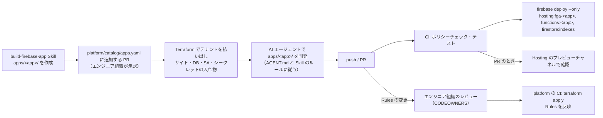

# ガードレール基盤（Firebase）設計 — ガバナンスと共有プロジェクト

非エンジニア（業務部門）が、経費精算や社内ニュースまとめのような簡単な社内アプリを **自分たちで作り、ホスティングし、社内に配布できる** 環境を、Firebase を土台にして作る。エンジニア組織（Google Cloud の管理者）が統制できる状態を保つことを前提にする。

- 最初のサンプルアプリ：[`news_watcher_design.md`](./news_watcher_design.md)
- 構築・運用の手順：[`runbook.md`](./runbook.md)
- 環境ごとの値（プロジェクト ID・社内ドメインなど）は [`platform/config.json`](../platform/config.json) の 1 か所で決める。以下の `<project>` はその `project_id`、サイトの接頭辞 `fga` は `site_prefix`

---

## 1. 基本方針

1. **事前承認ではなく、ガードレールで統制する**
   - 危険な操作は **技術的にできない状態にしておく**（使える API の制限・IAM・組織ポリシー）
   - 決まった型（Golden Path）に収まるアプリは、エンジニアのレビューなしでデプロイしてよい
   - 型から外れるもの（個人情報・お金・社外公開・SSR など）だけ、エンジニアがレビューする
2. **野良アプリは 1 つの共有プロジェクトに同居させる**
   - 業務部門が GCP プロジェクトを増やしていくと、管理者から見て棚卸し・課金・IAM・組織ポリシーの管理対象が増え続けて困る
   - Tier 0 / 1 のアプリは **1 つの共有プロジェクトの中の「テナント」** として払い出す
   - Tier 2（経費精算など）や、共有プロジェクトの上限を超えるものだけ、専用プロジェクトに切り出す
3. **業務部門の PC に強い権限を置かない**
   - デプロイは GitHub Actions ＋ Workload Identity Federation（WIF・鍵なし）からだけ行う
   - 業務部門のメンバーに付けるのは「自分のアプリを見る・自分のアプリの値を設定する」権限だけにする
4. **AI コーディングを前提にする**
   - 非エンジニアは AI エージェント（Antigravity / Gemini CLI など）で作る前提にする
   - ガードレールは **AI 向けのルール（`AGENT.md` と `.agents/skills/` の Agent Skill）** と **CI のチェック** の 2 段で守らせる
   - 言語は、AI が何も指定しなくても選びがちな **TypeScript（Node.js）** に揃える

---

## 2. アプリのリスク区分（Tier）

| Tier | 例 | 扱うデータ | 置き場所 | 構成 | 公開までの流れ |
|---|---|---|---|---|---|
| **0：セルフサービス** | **news-watcher**、社内リンク集、アンケート集計 | 社内一般（個人情報を含まない） | 共有 PJ | Hosting（静的）＋ Firestore（アプリ専用 DB）＋ Functions（定期実行・Firestore トリガーのみ） | 台帳に登録 → push → CI チェック → 自動デプロイ。標準の Rules テンプレートを使い、シークレットも外部への送信もないアプリは、データベースの払い出しまで承認なし（[§3.4](#34-承認待ちを減らす2-つのレーン予算データの持ち出し対策)）。**独自の Rules・シークレット・外部への送信があるときだけ、エンジニア組織がレビューして Terraform で反映** |
| **1：軽いレビュー** | 部署内の申請・承認フロー | 社員名・メールアドレス程度 | 共有 PJ | Tier 0 ＋ Storage（アプリ専用バケット） | エンジニアが Rules・IAM をレビュー |
| **2：エンジニア伴走** | **経費精算** | 金額・領収書・口座情報など | **専用 PJ** | Tier 1 ＋ 保存期間の設定・監査ログ・必要に応じて Cloud Run ＋ IAP | 設計レビュー・本番前チェック |

> [!IMPORTANT]
> Firebase Hosting の静的ファイル（HTML / JS）は **認証なしで誰でも取得できる**。全 Tier 共通のルールとして「静的ファイルに機密情報を入れない。データは必ず Firestore / Storage から Security Rules を通して取得する」を必須にする。

---

## 3. 1 つのプロジェクトに複数アプリを同居させる仕組み

Firebase は、1 つのプロジェクトの中で次のものを複数持てる。これを使い、**1 アプリ ＝ 1 テナント（専用の Hosting サイト・専用の Firestore DB・専用の Functions codebase・専用の実行 SA）** として分ける。

| 機能 | 1 PJ で複数持てるか | 分け方 | 制約・メモ |
|---|---|---|---|
| Web アプリ登録 | ✅ | アプリごとに登録（App Check もここに紐付く）。**Web API キーもアプリ専用にし、自分のサイトのリファラと Firebase の API だけに絞る** | Web API キーは画面に埋め込まれて公開されるため |
| Hosting | ✅ 複数サイト（上限 36 程度。要確認） | アプリごとにサイト `fga-<app>`（URL は `https://fga-<app>.web.app`） | サイト単位の IAM はない → デプロイ権限は CI で制御 |
| Firestore | ✅ 複数データベース（上限 100 程度。要確認） | アプリごとに DB `<app>` を作成。**Security Rules とインデックスは DB ごとに独立** | IAM Conditions で、実行 SA がアクセスできる DB を限定できる |
| Cloud Functions | ✅ **codebase** で分割 | `firebase.json` の `codebase: "<app>"`。あるアプリのデプロイで、他のアプリの関数が消えることはない | **関数名は PJ 全体で一意** → 関数はアプリ名のグループで export する（`newsWatcher-xxx`） |
| Cloud Storage | ✅ 複数バケット | アプリごとにバケット `<project>-<app>`。Rules もバケットごと | Tier 1 以上 |
| Secret Manager | ✅ | シークレット名の先頭に `<APP>_` を付ける（英大文字・数字・アンダースコアのみ。firebase-tools の制約）。IAM はシークレット単位 | |
| Firebase Auth | ❌ PJ で 1 つ | **全アプリで共通**（社員全員が利用者なので問題ない）。アプリごとの権限は、各アプリの DB の `members` で管理 | 必要になれば Identity Platform のマルチテナントを使う |
| Vertex AI（Gemini） | PJ で共通 | リクエストに `labels: {app: <app>}` を付けて費用を分けて集計 | クォータは全アプリで共有 |

### 3.1 名前の付け方（app id = `news-watcher` の場合）

| リソース | ルール | 例 |
|---|---|---|
| app id | 英小文字で始まり英小文字か数字で終わる、英小文字・数字・ハイフンの 4〜20 文字（Firestore の DB 名にも使うため 4 文字以上）。ハイフンを除くと同じになる id は不可（関数のサービス名が重なる）。台帳 `platform/catalog/apps.yaml` のキー | `news-watcher` |
| Hosting サイト | `fga-<app>`（サイト ID は世界で一意） | `fga-news-watcher` |
| Firestore DB | `<app>` | `news-watcher` |
| Functions codebase | `<app>` | `news-watcher` |
| 関数名 | `<appのcamelCase>-<関数名>` | `newsWatcher-fetchSources` |
| 実行 SA | `app-<app>@<project>.iam.gserviceaccount.com` | `app-news-watcher@...` |
| シークレット | `<APP>_<名前>`：app id と台帳の名前を英大文字にし、ハイフンをアンダースコアに（`defineSecret` の名前は環境変数名になるため、firebase-tools は英大文字・数字・アンダースコアしか認めない） | `NEWS_WATCHER_SLACK_WEBHOOK_GENERAL` |
| Storage バケット | `<project>-<app>` | （Tier 1 以上） |
| ラベル | `app=<app>`, `tier=<n>`, `owner-team=<部署>` | 関数・バケット・Vertex AI リクエストに付ける |
| オーナーグループ | `fga-<app>-owners@<domain>`（Google グループ） | Google グループを推奨。検証ではユーザーを直接指定してもよい |

### 3.2 同居させることの限界と対策

| 限界 | 影響 | 対策 |
|---|---|---|
| **Security Rules** の権限（`firebaserules.admin`）は PJ 単位でしか付けられない（Rules はサイトや DB の下ではなく PJ 直下のリソース） | あるアプリのデプロイ SA が、他のアプリの DB の Rules を全開放で上書きでき、**そのアプリのデータが漏れる** | **Rules はエンジニア組織が Terraform で反映する**。アプリのデプロイ SA には Rules の権限を付けない（[§3.3](#33-security-rules-は-terraform-で反映する)） |
| **Hosting** の権限（`firebasehosting.admin`）は PJ 単位でしか付けられない（サイト単位の IAM がない） | デプロイ SA が、他のアプリの画面を上書きできてしまう | デプロイは **CI だけ**が行い、CI のポリシーチェックで「`apps/<app>/firebase.json` が自分のサイト・DB・codebase しか参照していないこと」を確認する（[§5](#5-ci-のポリシーチェック)）。静的ファイルには機密情報を入れないルールなので、上書きされても漏れるのは画面のファイルだけ |
| Functions の **新規作成**・Cloud Scheduler・Eventarc の権限は PJ 単位（Firebase に限らず、普通の GCP でも同じ） | デプロイ SA が、他のアプリの関数名で新しい関数を作れてしまう | 関数名の決まり（`<appのcamelCase>-<関数名>`）を CI でチェックする。既存の関数の更新は、関数単位の IAM で分けられる |
| Firebase コンソールの閲覧権限は PJ 全体に効く | 業務部門の人が、他のアプリの設定を見られてしまう | 業務部門にはコンソールの PJ 権限を基本的に付けない。必要な画面は個別の権限で渡す：データは DB を限定した IAM Conditions、ログは Log View、シークレットは値の追加権限だけ |
| クォータ・障害の影響が全アプリに及ぶ | 1 つのアプリの暴走（無限ループ・大量の Gemini 呼び出し）が、他のアプリに影響する | 関数ごとに `maxInstances` を必須にし、処理件数の上限を設ける。予算アラートをラベル単位で設定 |
| 費用の内訳を出しにくい | アプリごとの費用を出すには工夫が要る | 関数・バケット・Vertex AI のリクエストにラベルを付け、Billing Export で集計。Firestore の DB ごとの内訳が取れるかは要確認 |
| Auth が共通 | あるアプリの利用者が、他のアプリにもログインできる | 社員全員が利用者なので許容する。アプリごとの認可は各 DB の `members` と Rules で行う |

> [!NOTE]
> 次のどれかに当てはまったら、**専用 PJ に切り出す**：Tier 2 になった／共有 PJ の上限（サイト数など）に近づいた／独自の IAM や組織ポリシーが必要になった。切り出し用に `platform/terraform/modules/` のモジュールを、共有 PJ 向けと専用 PJ 向けの両方で使えるように作っておく。

### 3.3 Security Rules は Terraform で反映する

共有 PJ でアプリ同士のデータを分ける最後の砦は、DB ごとの Security Rules である。ところが Rules の権限は PJ 単位でしか付けられないため、**Rules の本番への反映はエンジニア組織の Terraform だけが行う**。Rules を書くのは業務部門のまま。

| 項目 | 内容 |
|---|---|
| 書く人 | 業務部門。`apps/<app>/firestore.rules`（Tier 1 以上は `storage.rules` も）。標準テンプレート（`platform/rules-templates/`）で足りるアプリは書かない（[§3.4](#34-承認待ちを減らす2-つのレーン予算データの持ち出し対策)） |
| テスト | アプリの CI でエミュレータを使って Rules のユニットテストを実行し、ポリシーチェック（全開放の禁止、`isInternal()` の必須など）も行う |
| レビュー | CODEOWNERS で `apps/*/firestore.rules` と `apps/*/storage.rules` はエンジニア組織のレビューを必須にする |
| 反映 | マージされると platform の CI が `terraform apply` する。Terraform は `apps/<app>/firestore.rules` をファイルとして読み、`google_firebaserules_ruleset` と `google_firebaserules_release`（リリース名 `cloud.firestore/<app>`）を作る |
| アプリのデプロイ SA | `firebaserules.*` の権限を付けない。誤って `firebase deploy` に Rules を含めても、権限エラーになり反映されない |
| `firebase.json` | エミュレータと Rules のテストのために `rules` を書いてよい。CI のデプロイは `--only hosting:fga-<app>,functions:<app>,firestore:indexes`（Rules を含めない） |
| `firestore.rules` がまだないアプリ | 台帳に登録した時点では **全拒否の Rules** を反映する（Rules を書いて PR を出すまで、データにはアクセスできない） |
| 使っていない DB・バケット | `(default)` DB・既定のバケットは作らない（存在しないものには誰もアクセスできない。デプロイ SA には DB やバケットを作る権限もない） |
| ずれ（ドリフト）の検知 | コンソールなどで Rules が直接変更されていないか、platform の CI で定期的に `terraform plan` を実行して確認する |

```hcl
# platform/terraform/modules/app-tenant/rules.tf（イメージ）
resource "google_firebaserules_ruleset" "firestore" {
  project = var.project_id
  source {
    files {
      name    = "firestore.rules"
      content = file("${var.apps_dir}/${var.app_id}/firestore.rules")
    }
  }
  lifecycle { create_before_destroy = true }
}

resource "google_firebaserules_release" "firestore" {
  project      = var.project_id
  name         = "cloud.firestore/${google_firestore_database.app.name}"
  ruleset_name = "projects/${var.project_id}/rulesets/${google_firebaserules_ruleset.firestore.name}"
  lifecycle { replace_triggered_by = [google_firebaserules_ruleset.firestore] }
}
```

> [!NOTE]
> Rules はデータ漏えいに直結するので、独自の `firestore.rules` の変更にはエンジニア組織のレビューを残す。画面・関数・インデックスの変更は、業務部門だけで出せる。一方で、アプリを 1 つ作るたびにレビュー待ちになると、また人が詰まる。そこで次節のとおり、**事前に承認した標準の Rules テンプレートを使う Tier 0 のアプリは、CI の検査を通ればデータベースの払い出しまで承認なしで反映する**。

### 3.4 承認待ちを減らす：2 つのレーン・予算・データの持ち出し対策

**1. 2 つのレーン（台帳を 2 か所に分ける）**

| | セルフサービス | エンジニア確認 |
|---|---|---|
| 台帳 | `platform/catalog/self-service/<app>.yaml`（1 アプリ 1 ファイル） | `platform/catalog/apps.yaml` |
| 置けるアプリ | Tier 0、`data_class` が `public` / `internal`、`handles_pii: false`、`rules_template` が標準テンプレート（`internal-team-collab` / `internal-author-only`）、`secrets` と `external_egress` なし、オーナーが社内ドメイン | それ以外（独自の `firestore.rules`、シークレット、外部への送信、Tier 1） |
| PR のレビュー | 不要（CODEOWNERS の対象から外している） | エンジニア組織（CODEOWNERS） |
| 型から外れたら | CI のポリシーチェックが違反にする（`BLOCKED`）。Terraform の precondition でも止める | — |
| 反映（`terraform apply`） | 承認なし。ただし plan の中身が「そのアプリのテナントの作成・変更」だけのとき（`platform/policies/plan-guard.mjs`） | Environment `platform` の承認の後 |
| 判定の表示 | `AUTO_APPROVE_ELIGIBLE` | `ENGINEER_REVIEW_REQUIRED`（理由つき） |

- レーンを **ファイルの場所** で分けるのは、GitHub の CODEOWNERS がパス単位でしか指定できないため。場所で分けたうえで、置いてよい内容かどうかを CI が確かめる。
- 標準テンプレートは `platform/rules-templates/*.rules`。Terraform がこのファイルをそのまま反映する。アプリのディレクトリには、エミュレータ用の写し（`firestore.standard.rules`）だけを置く（firebase-tools は、アプリのディレクトリの外にある Rules を読めないため）。写しがテンプレートと違えば CI が止める。本番に反映されるのは常にテンプレートのほう。
- 承認なしの反映は、plan を取り直して検査し、**検査した plan そのもの** を apply する。`main` にまだ承認されていない別の変更（基盤・他のアプリ）が残っていれば plan に現れるので、自動では反映せず、承認つきのレーンに回る。削除だけの変更と、データベースの作り直しも自動では反映しない。アプリを足すと必ず変わる共通のリソース（台帳の検証 `terraform_data.catalog_check` と、Auth の許可ドメイン）は、変わり方がそのアプリの分だけであることを確かめて認める。
- 残るリスク：セルフサービスの台帳はレビューなしで変更できるので、他のセルフサービスのアプリの `owners` / `admins` を書き換えられる（対象は個人情報を持たない Tier 0 のアプリだけ。変更は Git の履歴と監査ログに残る）。

**2. 予算アラート（初回構築で作る）**

- `platform/terraform/budget.tf` が、共有プロジェクト全体とアプリ別（ラベル `app=<id>`。台帳の `budget_jpy`）の月額予算を作り、実績 50% / 90% / 100% と予測 100% で、Pub/Sub トピック `fga-budget-alerts`・メール・課金アカウントの管理者に通知する。
- **予算アラートは通知だけで、課金は止まらない。** 共有プロジェクトの課金アカウントを外すと、同居する全アプリが止まる。上限そのものは、関数の `maxInstances` と API のクォータで決める。止める仕組みを足すなら、Pub/Sub を購読して該当アプリの関数だけを止める。
- 予算の作成には課金アカウント側の権限が要る。bootstrap が Terraform SA に `roles/billing.costsManager` を付ける。もらえない環境だけ、`platform/config.json` の `enable_budgets` を `false` にする。

**3. データの持ち出し対策（4 層）**

| 層 | 内容 |
|---|---|
| 作る前の確認（Skill） | `build-firebase-app` が、コードを書く前に、個人情報・社外秘・外部への送信・保持期間を確かめる。当てはまれば Tier 1 / 2 に回す |
| PR の注意と検査（CI） | `ci.yml` が PR に、データの取り扱いの注意と判定をコメントする。ポリシーチェックは、Tier 0 での `confidential`・`handles_pii: true`、HTTP 関数、全開放の Rules、秘密情報の直書きを違反にし、`safeFetch` を通さない `fetch()` をエンジニア確認に回す（セルフサービスでは違反）。一時的なデータは、台帳の `ttl_collections` で TTL（`expiresAt`）を付けられる |
| データベース作成の監査アラート（Terraform） | `platform/terraform/audit_alerts.tf`。データベースの作成は、追加料金なしで記録される管理アクティビティ監査ログ（`FirestoreAdmin.CreateDatabase`）に残る。ログの一致で通知するアラートを 2 つ作る：①データベースが作られた、②Terraform SA 以外が作った。通知先は Pub/Sub トピック `fga-governance-alerts` とメール |
| 発展（必要な組織だけ） | 外部への通信をネットワークで絞る（Direct VPC Egress ＋ Secure Web Proxy の許可ドメイン）、誤って入った個人情報を探す（Sensitive Data Protection の定期スキャン）。Firestore のデータアクセス監査ログをすべて有効にすると、読み書きの量に応じてログの費用が増える |

---

## 4. 役割分担と IAM

### 4.1 誰が何を管理するか

| 項目 | エンジニア組織（`platform/`・Terraform） | 業務部門（`apps/<app>/`・CI で firebase deploy） |
|---|---|---|
| 共有 PJ の作成・課金紐付け・使える API・組織ポリシー | ✅ | |
| Firebase Auth（Identity Platform・Google ログイン・ドメイン制限） | ✅ | |
| テナントの払い出し（Hosting サイト・Firestore DB・TTL・Web アプリ登録・実行 SA・シークレットの入れ物・予算アラート） | ✅（台帳に 1 件追加するだけ） | 台帳への追加 PR を出す（標準の型なら `self-service/` に置き、レビューなしで反映される） |
| 共通の関数（Auth の blocking function など）＝ codebase `platform` | ✅ | |
| **Security Rules の本番への反映**（Firestore / Storage。Rules がまだないアプリの全拒否も含む） | ✅（レビューしてから Terraform で反映） | Rules を書いてテストし、PR を出す |
| 画面、インデックス、関数のコード、定期実行のスケジュール | | ✅ |
| シークレットの値（Webhook URL など） | | ✅（オーナーが登録） |

### 4.2 IAM

| 主体 | 主なロール | 範囲 |
|---|---|---|
| `terraform-sa`（エンジニア組織） | `editor`・`projectIamAdmin`・`firebase.admin`・`firebaserules.admin`・`identityplatform.admin` など（**Security Rules を反映できるのはこの SA だけ**） | 共有 PJ |
| `fga-deployer`（CI のデプロイ SA。WIF で借用） | `firebasehosting.admin`, `datastore.indexAdmin`, `cloudfunctions.developer`, `cloudscheduler.admin`, `eventarc.developer`, `run.viewer`, `secretmanager.viewer`, `firebase.viewer`, `artifactregistry.reader`。**`firebaserules.*` は付けない**（例外：Rules のコンパイル確認だけの `firebaserules.rulesets.test`。反映はできない）。ほかにカスタムロール `fgaDeployerExtras` で `run.services.setIamPolicy`（スケジュール関数の invoker の設定。§9） | PJ（上記のとおり細かく分けられない）。各アプリの実行 SA への `iam.serviceAccountUser` はアプリ単位で付与。ほかに、ビルド用の Compute Engine の既定 SA と、App Engine の既定 SA（`<project>@appspot`。firebase-tools がデプロイ前に必ず確認する。ロールは何も持たせない）への `iam.serviceAccountUser` |
| `app-<app>`（アプリの実行 SA） | `datastore.user`（**IAM Conditions で自分の DB だけ**）、`run.invoker`（**IAM Conditions で自分の関数だけ**。Firestore トリガー・スケジュール関数の呼び出しに必要）、`secretmanager.secretAccessor`（自分のシークレットだけ）、`aiplatform.user`、`logging.logWriter`、`eventarc.eventReceiver` | 自分のアプリのリソースだけ（最後の 3 つは PJ 単位） |
| `fga-<app>-owners`（業務部門） | `datastore.viewer`（自分の DB だけ）、`logging.viewAccessor`（自分の Log View だけ）、`secretmanager.secretVersionAdder`（自分のシークレットだけ）、`artifactregistry.reader`（npm リモートリポジトリ） | 自分のアプリのリソースだけ |
| Compute Engine の既定 SA | `cloudbuild.builds.builder` だけ | Functions のビルド用（実行には使わせない） |

---

## 5. CI のポリシーチェック

PR では [`platform/policies/check.mjs`](../platform/policies/check.mjs)（`pnpm policy`）が全アプリを確認する（[`.github/workflows/ci.yml`](../.github/workflows/ci.yml)）。`main` にマージされると、`apps/<app>/**` に変更があったアプリだけを GitHub Actions の matrix でデプロイする（[`deploy.yml`](../.github/workflows/deploy.yml)）。

> [!NOTE]
> 下の表のうち、**Rules のユニットテスト（エミュレータ）と gitleaks は未実装**。関数の設定（`serviceAccount`・`maxInstances`・`labels`）は、共通の設定オブジェクトを使っているかを文字列で確かめる簡易チェックで、TypeScript の構文解析はしていない。

| チェック | 内容 |
|---|---|
| 台帳 | `platform/catalog/apps.yaml` か `platform/catalog/self-service/<app>.yaml` に登録済みで、スキーマどおりか（オーナー・部署・Tier・データ区分・`handles_pii`・`rules_template`・有効期限）。Tier 0 で `confidential`・`handles_pii: true` は不可。アプリ数は 30 まで。台帳はアプリのディレクトリには置かない |
| レーン | `self-service/` のアプリが標準の型に収まっているか（[§3.4](#34-承認待ちを減らす2-つのレーン予算データの持ち出し対策)）。アプリごとの判定（`AUTO_APPROVE_ELIGIBLE` / `ENGINEER_REVIEW_REQUIRED` / `BLOCKED`）を、PR にコメントする |
| 担当範囲 | `firebase.json` が参照しているのは、自分の Hosting サイト・Firestore DB・codebase だけか |
| 関数 | 全関数に `serviceAccount: app-<app>@`、`region: asia-northeast1`、`maxInstances`、`labels.app` が指定されているか。関数がアプリ名のグループで export されているか。**Tier 0 では `onRequest` / `onCall`（HTTP 関数）を使っていないか** |
| Rules | `allow read, write: if true;` のような全開放がないか。全ルールが社内ドメインの確認（`isInternal()`）を通っているか（標準テンプレートも同じ検査を通す）。標準テンプレートの写しが、テンプレートと同じ中身か。Rules のユニットテスト（エミュレータ）が通るか。**本番への反映は platform の CI（Terraform）が行う**（[§3.3](#33-security-rules-は-terraform-で反映する)） |
| 秘密情報 | gitleaks で秘密情報が混入していないか。`firebase.json` や `web/` に Webhook URL などが書かれていないか |
| 依存パッケージ | `pnpm install --frozen-lockfile`（ロックファイルと違えば失敗）、OSV-Scanner でロックファイルを確認（既知の脆弱性・悪性パッケージ）、**依存の許可リスト**（テンプレートにない依存を追加していないか。追加はエンジニア組織のレビューが必要） |

CODEOWNERS でレビュー担当を分ける：`platform/**` と `apps/*/firestore.rules`・`apps/*/storage.rules` はエンジニア組織、それ以外の `apps/<app>/**` と `platform/catalog/self-service/*.yaml` はそのアプリのオーナー（Tier 0 なら自分たちでマージしてよい）。

---

## 6. ガードレール一覧

| 種類 | 内容 | 防ぎたいこと | Phase |
|---|---|---|---|
| 使える API の制限 | 共有 PJ で有効化するのは Firebase 関連と Vertex AI だけ。本番では `gcp.restrictServiceUsage` で許可リストにする | VM・GKE などの勝手な作成 | 1（API）/ 3（組織ポリシー） |
| リージョン | `gcp.resourceLocations` で日本リージョンに限定。Firestore と Functions は `asia-northeast1` | データの国外保存 | 3 |
| 社外共有の禁止 | 組織ポリシー `iam.allowedPolicyMemberDomains` | 社外アカウントへの権限付与 | 3（組織側で設定） |
| 認証 | Google ログイン ＋ Rules で `email_verified` と社内ドメインを確認。可能なら blocking function でも社外ドメインを拒否（二重チェック） | 社外の人のログイン・データアクセス | 1 |
| HTTP 関数を作らない（Tier 0） | 画面からは Firestore に書き込むだけにし、処理は Firestore トリガーと定期実行の関数で行う | `allUsers` の付与が必要になること（組織ポリシーとぶつかる）、不正な呼び出し | 2 |
| App Check | reCAPTCHA Enterprise で、自分たちのアプリ以外からの Firestore アクセスを拒否 | 公開されている Web API キーの悪用 | 3 |
| シークレット | Secret Manager に保存し、関数では `defineSecret` で読む | コードや Git への秘密情報の混入 | 2 |
| コスト | PJ 全体の予算アラートに加え、ラベル `app=<app>` 単位の予算アラート（台帳の `budget_jpy`）。関数の `maxInstances` と、1 回あたりの Gemini 呼び出し件数の上限。予算アラートは初回構築で作り、Pub/Sub・メールに通知する（通知だけで、課金は止まらない。[§3.4](#34-承認待ちを減らす2-つのレーン予算データの持ち出し対策)） | 高額請求 | 1 / 3 |
| ライフサイクル | 台帳の有効期限（`expires`）とオーナーを毎月棚卸し。期限切れのアプリはオーナーに通知した後で停止 | 誰も管理していないアプリが残り続けること | 4 |
| Web API キー | アプリごとに専用のキーを作り、自分のサイト（とプレビューチャネル）のリファラと Firebase の API だけに絞る | 公開されているキーの、他のサイト・他の API での悪用 | 1 |
| 監査 | データベースの作成を、管理アクティビティ監査ログからその場で通知する（`audit_alerts.tf`）。Firestore のデータアクセス監査ログ、アプリ単位の Log View | 台帳を通さないデータベース、事故が起きたときに追跡できないこと | 1（作成の通知）/ 3 |
| データ保持 | 記事などの一時データは Firestore TTL で自動削除（台帳の `ttl_collections`、または `firestore.indexes.json`） | 不要なデータの溜め込み | 2 |
| ソフトウェアサプライチェーン | pnpm（インストール時のスクリプトを既定で止める・公開から 7 日たった版だけを入れる）、取得先は Artifact Registry の npm リモートリポジトリだけ、CI で OSV-Scanner と依存の許可リスト（[§7.2](#72-パッケージ管理とサプライチェーン対策pnpm)） | 乗っ取られたパッケージ・悪性パッケージの混入 | 1 / 2 / 3 |

---

## 7. 開発・デプロイの流れ



### 7.1 ローカル開発（Emulator Suite）

ローカルでは **Firebase Emulator Suite** で動かして確認し、**本番（共有 PJ）へのデプロイは CI からだけ** 行う。

| 必要なもの | バージョン | 用途 |
|---|---|---|
| Node.js | 24 LTS。ルートの `.nvmrc` でバージョンを固定し、nvm で切り替える。Functions の実行環境も `nodejs24` に合わせる（使えなければ `nodejs22`。§9） | 画面・関数のビルドとテスト |
| pnpm | `package.json` の `packageManager` でバージョンを固定（12.16.1）。corepack で有効化する（`corepack enable pnpm`） | パッケージ管理（[§7.2](#72-パッケージ管理とサプライチェーン対策pnpm)） |
| Java（JDK） | 21 | Firestore / Auth のエミュレータ |
| firebase-tools | ルートの `package.json` の devDependencies でバージョンを固定し、`pnpm exec firebase` で使う | エミュレータ、Rules のテスト |

- リポジトリのルートを **pnpm workspace**（`apps/*/web`、`apps/*/functions`、`platform/functions`）にして、`pnpm install` 1 回で全アプリの依存をそろえる
- アプリのディレクトリで `pnpm exec firebase emulators:start --project demo-<app>` を実行する。プロジェクト ID を `demo-` で始めると、エミュレータは本物の PJ に一切つながらない
- スケジュール関数は、エミュレータでは自動では起動しない。`functions:shell` か、テスト用のスクリプトから手動で呼ぶ
- Gemini はエミュレータからも本物の Vertex AI を呼ぶ（ADC を使う）
- エミュレータで使うシークレットは `functions/.secret.local` に書く（Git 管理外）
- 業務部門にも同じ手順（`pnpm install` → `emulators:start`）を案内する。ローカルからの `firebase deploy` は、権限を付けないことで防ぐ

### 7.2 パッケージ管理とサプライチェーン対策（pnpm）

npm のエコシステムでは、人気パッケージの乗っ取り（2025 年の chalk / debug など）や、インストール時のスクリプトで広がるワーム（Shai-Hulud）が実際に起きている。業務部門や AI エージェントが依存を気軽に増やしがちな環境なので、**パッケージマネージャーは pnpm に統一し、安全側の設定を既定にする**。

| 主な攻撃 | npm の既定 | この基盤での対策 |
|---|---|---|
| インストール時に任意のコードが動く（`postinstall` など） | すべて実行される | pnpm は **既定で実行しない**。`allowBuilds` で true にしたもの（esbuild など）だけ許可し、`strictDepBuilds` で許可外があればインストールを失敗させる |
| 乗っ取られた最新版を、公開直後に取り込む | すぐ入る | **`minimumReleaseAge`**：公開から 7 日たった版だけ入れる（乗っ取りの多くは数時間〜数日で見つかって取り下げられる） |
| package.json に書いていないパッケージを使えてしまう（幽霊依存） | 使えてしまう | pnpm の厳格な `node_modules` 構造で使えない |
| ロックファイルと違う版が入る | `npm ci` を使えば防げる | CI では `pnpm install --frozen-lockfile` |
| 取得先の乗っ取り・どの版を取ったか追えない | npmjs.com に直接取りに行く | **Artifact Registry の npm リモートリポジトリ**（共有 PJ に 1 つ）だけを取得先にする。取得の記録が監査ログに残り、遮断や調査の起点になる |
| 既知の脆弱性・悪性パッケージ | `npm audit` | CI で **OSV-Scanner**（Google 製）がロックファイルを確認する |
| 業務部門・AI エージェントが依存を勝手に増やす | 制限なし | テンプレートで使える依存を決め、CI の **許可リスト** で止める。`AGENT.md` と Skill に「依存を追加しない。必要ならエンジニア組織に相談」と書く |
| 更新が止まって古い版のまま | — | Dependabot（`cooldown`）か Renovate（`minimumReleaseAge`）で数日待ってから更新の PR を出す。ロックファイルの差分は PR で確認する |

`pnpm-workspace.yaml` の設定（pnpm 12 の設定名。実物は [`pnpm-workspace.yaml`](../pnpm-workspace.yaml)）

```yaml
packages:
  - "apps/*/web"
  - "apps/*/functions"
  - "platform/functions"
minimumReleaseAge: 10080        # 公開から 7 日（分単位）たった版だけ入れる
trustPolicy: no-downgrade       # 以前の版より信頼性（署名・provenance）が下がった版を拒否する
blockExoticSubdeps: true        # 推移的な依存に git / tarball URL などレジストリ以外の取得元を許さない
strictDepBuilds: true           # 許可していないスクリプトがあれば、インストールを失敗させる
allowBuilds:                    # インストール時のスクリプト：true = 実行する / false = 内容を確認したうえで実行しない
  esbuild: true
  protobufjs: false             # バージョン確認だけ
  re2: false                    # firebase-tools の依存。GitHub からバイナリを取得する。なくても firebase-tools は動く
```

> [!NOTE]
> pnpm 12 では、pnpm 10 の `onlyBuiltDependencies`（配列）が `allowBuilds`（パッケージ名 → true / false）に変わった。許可していないスクリプトを持つ依存が入ると、`pnpm add` / `install` が `ERR_PNPM_IGNORED_BUILDS` で止まるので、**中身を確認して true か false を決める**（何をするスクリプトかを `pnpm-workspace.yaml` にコメントで残す）。

`.npmrc`（Artifact Registry を取得先にする。Phase 1 で作成）

```ini
registry=https://asia-northeast1-npm.pkg.dev/<project>/npm-remote/
always-auth=true
```

> [!WARNING]
> **Functions はクラウド側のビルドで依存を入れ直す。** `firebase deploy` すると、`functions/` だけがアップロードされ、Cloud Build（buildpacks）がその `package.json` から依存をインストールする。pnpm workspace のルートにあるロックファイルや上記の設定は、そのままでは効かない。
> 対策として、**関数は esbuild で 1 ファイルにまとめ、デプロイする `package.json` の依存を `firebase-functions` / `firebase-admin` などの最小限にする**。クラウド側で入る依存を最小限にし、その分のロックファイルを一緒にアップロードする。具体的なやり方は Phase 2 で確認する（[§9](#9-実機で分かったこと未確認事項)）。

---

## 8. 進め方

| Phase | 内容 | 成果物 | クラウドの変更 |
|---|---|---|---|
| **0. ドキュメント** | 本ドキュメント・news-watcher の設計・移行対応表 | `docs/` | なし |
| **1. 共有 PJ とテナント払い出し** | `bootstrap/`（PJ・Terraform SA・tfstate）、共有 PJ に Firebase を追加、Identity Platform・Google ログイン、`modules/app-tenant`（サイト・DB・Web アプリ登録・SA・シークレットの入れ物・**Security Rules の反映**）、デプロイ SA と WIF、予算アラート、Artifact Registry の npm リモートリポジトリ | `platform/terraform/`、`scripts/` | あり（承認後に apply） |
| **2. news-watcher MVP** | 情報源の管理、定期取得、Gemini で要約、Slack / Google Chat に配信、画面 | `apps/news-watcher/` | あり（承認後にデプロイ） |
| **3. ガバナンス強化** | CI のポリシーチェック（✅ `platform/policies/`）・GitHub Actions からのデプロイ（✅ `.github/workflows/`）、App Check、Log View、ラベル単位の予算、監査ログ、組織ポリシー | `platform/policies/`、`.github/workflows/` | あり |
| **4. Skill 化と展開** | 2 つの Agent Skill（✅ `.agents/skills/init-firebase-platform`・`build-firebase-app`）、2 本目以降のアプリ、Tier 2（専用 PJ）の設計 | `.agents/skills/` | 必要に応じて |

---

## 9. 実機で分かったこと・未確認事項

| 項目 | 内容 | 対応 |
|---|---|---|
| blocking function と社外共有の禁止 | Auth の blocking function は Identity Platform から HTTP で呼ばれるため、`allUsers` の付与が必要になる可能性がある（`iam.allowedPolicyMemberDomains` とぶつかる） | Phase 1 で確認する。だめなら Rules のドメイン確認だけで守る（データアクセスはこれで防げる） |
| Firestore の複数 DB のデプロイ指定 | `firebase.json` の `firestore` を配列にして DB ごとに指定する方式と、インデックスだけを DB を指定してデプロイする方法（`--only firestore:indexes` で全 DB 分が対象になるか） | Phase 2 で、使っている firebase-tools のバージョンで確認する |
| Rules のリリース名 | 名前付き DB の Rules のリリース名が `cloud.firestore/<db>` で正しいか、Terraform（`google_firebaserules_release`）で反映できるか | Phase 1 で確認する |
| Firestore の IAM Conditions | DB の名前で条件を付けられるか（`resource.name == "projects/<p>/databases/<app>"`） | Phase 1 で確認する |
| サービスエージェントの作成が遅れる | Functions・Eventarc・Firebase Rules のサービスエージェントがまだなく、初回デプロイで失敗する | Service Usage API の `generateServiceIdentity` で先に作る（`scripts/deploy_platform.sh`）。それでも出たら 1〜2 分待って再実行する |
| 既定の Compute SA にロールがない | Functions（第 2 世代）のビルドと実行が失敗する | 実行 SA は関数ごとに `app-<app>@` を指定させる（CI でチェック）。ビルドは既定 SA で行われるので、`cloudbuild.builds.builder` だけを付ける（`deployer.tf`）。専用のビルド SA を firebase CLI から指定できるようになれば切り替える |
| firebase-tools の App Engine 既定 SA の確認 | `firebase deploy` は、関数を含むときに必ず `<project>@appspot.gserviceaccount.com` への `iam.serviceAccounts.actAs` を確認し、なければ止まる（関数の実行 SA を指定していても。firebase-tools 15.34 の `checkServiceAccountIam`）。2026-11-12 の初回デプロイで発生 | デプロイ SA にこの SA の `serviceAccountUser` を付ける（`deployer.tf`）。この SA にはロールを何も付けないので、借用できても権限は増えない。CI のチェックで関数の実行 SA が `app-<app>@` であることを確認するので、実行に使われることもない |
| firebase-tools の初回デプロイ時の IAM 確認 | PJ で最初に関数をデプロイするとき、firebase-tools は Pub/Sub のサービスエージェントへの `iam.serviceAccountTokenCreator` と、Compute Engine の既定 SA への `run.invoker`・`eventarc.eventReceiver` を確認し、なければ自分で付けようとする（デプロイ SA には権限がないので失敗する）。2026-11-12 の初回デプロイで発生 | platform の Terraform で付ける（`deployer.tf` の `functions_service_agents`）。**リスク**：関数のビルドは Compute Engine の既定 SA で動くため、あるアプリのビルド（依存のインストール時のスクリプトなど）から、他のアプリの関数を呼べてしまう可能性がある。関数は esbuild で 1 ファイルにまとめ、クラウド側で入れる依存を `firebase-functions` / `firebase-admin` だけにしているので可能性は低い。専用のビルド SA を指定できるようになったら、既定 SA のロールを外す |
| `firebase deploy --only firestore:indexes` と Rules | `firebase.json` に `rules` が書いてあると、インデックスだけをデプロイするときも Rules のコンパイル確認（`firebaserules.rulesets.test`）が呼ばれ、`firebaserules.*` を持たないデプロイ SA では 403 になる。2026-11-12 の初回デプロイで発生 | **案 A を採用**：`firebaserules.rulesets.test`（コンパイル確認だけ。Rules の作成・反映はできない）を、下の行のカスタムロール `fgaDeployerExtras` に入れてデプロイ SA に付ける。ほかの案：B. インデックスと TTL も platform の Terraform で反映する（`google_firestore_index` / `google_firestore_field`）、C. CI 用に `rules` を書かない `firebase.json` を `--config` で使う |
| スケジュール関数の invoker の設定 | firebase-tools はスケジュール関数を作るたびに、Cloud Run サービスの `run.invoker` を実行 SA に設定する（`setIamPolicy`）。`cloudfunctions.developer` / `run.viewer` には `run.services.setIamPolicy` がなく失敗し、スケジューラのジョブも作られない。2026-11-12 の初回デプロイで発生 | デプロイ SA にカスタムロール `fgaDeployerExtras`（`run.services.setIamPolicy` と、上の行の案 A の `firebaserules.rulesets.test`）を付ける。terraform-sa に `iam.roleAdmin` を足す（bootstrap）。**リスク**：デプロイ SA が他のアプリの関数の invoker も変えられる（Hosting・関数の作成と同じく PJ 単位でしか分けられない。CI のポリシーチェックと、組織ポリシー `iam.allowedPolicyMemberDomains` で `allUsers` を付けられないことで守る） |
| 関数のコンテナイメージの削除ポリシー | firebase-tools は `gcf-artifacts` リポジトリに削除ポリシー（`firebase-functions-cleanup`）がないと、デプロイの最後でエラーにする。デプロイ SA にはリポジトリを変更する権限がない | `gcf-artifacts` を platform の Terraform で作り、削除ポリシー（1 日より古いイメージを削除）を付ける。Functions が先に作ってしまった PJ では `terraform import` する |
| Google ログインの OAuth クライアント | Google ログインには OAuth クライアントが必要だが、API（Terraform）からは作れない | コンソールで作り、ID とシークレットを `terraform.tfvars`（Git 管理外）に書く。空なら Firebase コンソールで Google プロバイダを有効化する（[runbook](./runbook.md)） |
| IAM Conditions の書き方 | Firestore（`projects/<p>/databases/<db>`）と Cloud Run の `resource.name` の形式 | **Firestore**：実行 SA の `datastore.user` を DB 名の条件で絞る形で、関数から自分の DB を読み書きできることを確認（2026-11-12）。**Cloud Run**：PJ 単位の `run.invoker` を `resource.name` の条件（`projects/...` の startsWith、`/services/`・`/routes/` の extract のどれも）で絞ると、Eventarc からの呼び出しが 403 になった。→ **条件付きの PJ 単位の `run.invoker` はやめ、デプロイの後に自分の関数のサービスごとに `run.invoker` を付ける**（`scripts/deploy_app.sh`。デプロイ SA の `fgaDeployerExtras` で実行）。Terraform の `runtime_invoker` は次の apply で外す。他のアプリの DB・関数にアクセスできないことの確認は、2 つ目のテナントで行う |
| Hosting サイト・Firestore DB の上限 | 共有 PJ に同居できるアプリ数の上限になる | 上限値を確認し、近づいたら専用 PJ に切り出すルールを §3.2 に書いておく |
| Functions のクラウド側ビルドでの依存インストール | pnpm workspace のロックファイルや `minimumReleaseAge` などの設定が、Cloud Build（buildpacks）では効かない | esbuild で 1 ファイルにまとめ、デプロイする依存を最小限にする（§7.2）。buildpacks が pnpm のロックファイルや Artifact Registry の取得先を使えるかも Phase 2 で確認する |
| Functions の実行環境 `nodejs24` | ローカルは Node.js 24。Cloud Functions for Firebase（第 2 世代）で `nodejs24` が GA で、firebase-tools と firebase-functions が対応しているか | Phase 2 で確認する。使えなければ実行環境だけ `nodejs22` にする（ローカルとの差は小さい） |
| `minimumReleaseAge` と緊急のセキュリティ修正 | 7 日待つ設定のため、脆弱性の修正版もすぐには入らない | `minimumReleaseAgeExclude` で、その修正版だけを例外にする（エンジニア組織が判断する） |
| Firebase Studio などクラウド IDE の提供状況 | 非エンジニアの開発環境の候補 | 提供状況を確認してから判断する（基本は Antigravity ＋ このリポジトリの Skill） |
| 2 つのレーンの自動反映 | `deploy.yml` の自動反映（`platform-apply-auto`）と `plan-guard.mjs` は、単体テストと構文の検査だけで、GitHub Actions の上では動かしていない | 実際のリポジトリで、セルフサービスのアプリを 1 つ追加して確かめる。確かめるまでは、最初の数回は plan を目で見る |
| Environment の Required reviewers | 承認つきの反映は、Environment `platform` の Required reviewers に頼っている。private リポジトリでは、GitHub のプランによって設定できない | 設定できない環境では、PR のレビュー（CODEOWNERS）だけが歯止めになる。`deploy.yml` を手動実行（`workflow_dispatch`）だけにする運用も検討する |
| 予算アラートの権限 | 予算の作成には、課金アカウント側の `billing.budgets.create` が要る。bootstrap が Terraform SA に `roles/billing.costsManager` を付けるが、実行する人に課金アカウントの IAM を変える権限がないと失敗する | 課金アカウントの管理者に付けてもらう。もらえなければ `enable_budgets: false` |
| 監査アラートの Pub/Sub 通知 | Cloud Monitoring の通知用サービスエージェント（`service-<番号>@gcp-sa-monitoring-notification`）に、トピックへの publish を付ける。このサービスエージェントは最初の Pub/Sub 通知チャネルを作ったときにできるため、初回の apply で権限の付与が失敗することがある | 1〜2 分待って再実行する |
| `ttl_collections` と `firestore.indexes.json` | TTL を Terraform（`google_firestore_field`）と `firebase deploy --only firestore:indexes`（`fieldOverrides`）の両方から同じ項目に設定すると、互いに上書きする | 1 つのコレクションの TTL は、どちらか一方で設定する（news-watcher は `firestore.indexes.json` の `expireAt`） |
